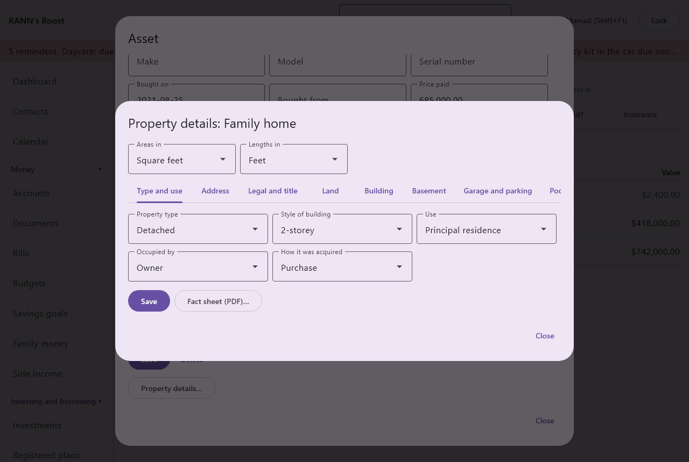
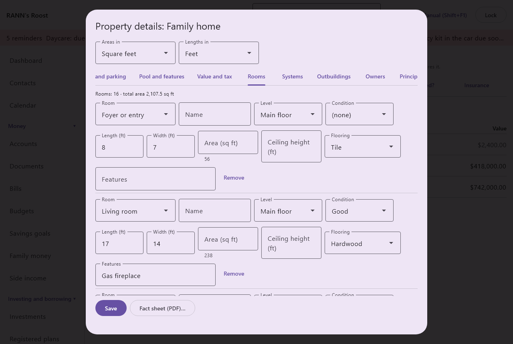
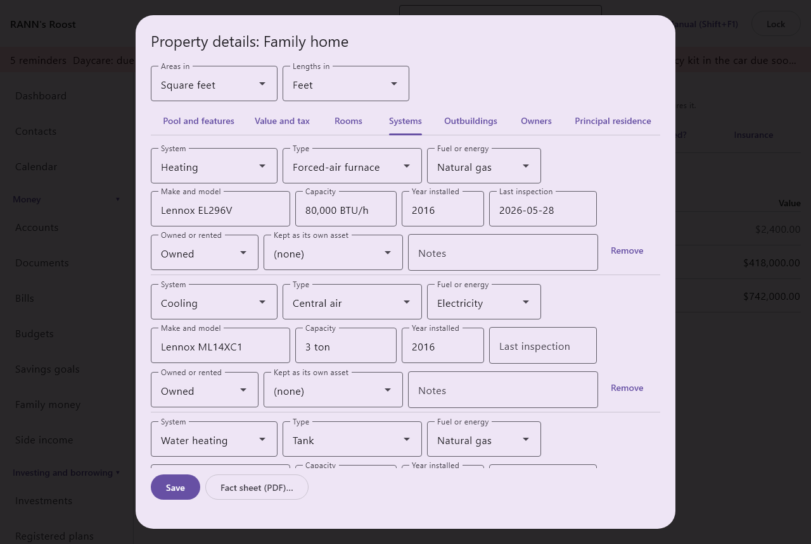
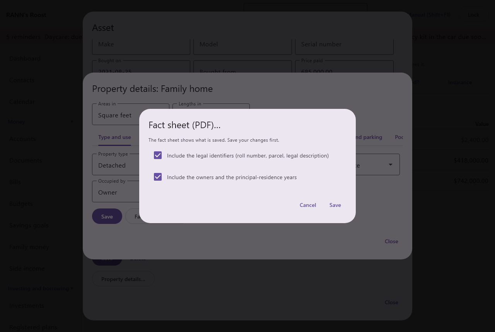

# Property details

Property details keep everything about a house, cottage, condo, piece of land or building in one place: its address and legal description, the land, the building, every room, the furnace and the well, the outbuildings, who is on title and the years it was your principal residence. Everything is optional: record only the address of a cottage, or every detail of the house. What you record can be printed as a fact sheet for an insurer, a buyer, an executor or a contractor.

@index: real estate; house; cottage; condo; land; building; roll number; parcel; PIN; PID; cadastre; fact sheet; T2091; principal residence

## Open the property details {#open}

1. Open [Home and assets](assets), **Assets** tab.
2. Click a home, cottage, condo, land or building, or add one with **Add an asset** and choose its **Kind**. See [Add or edit an asset](assets#asset-form).
3. Save the asset, then click **Property details…**. The button is under the asset's buttons, above the warranties; it shows only for the kinds **Home**, **Cottage**, **Condo**, **Land** and **Building**, and only once the asset is saved.

The dialog is titled "Property details:" and the asset's name. You need the **Edit** permission on the asset's group to save changes.

## The dialog at a glance {#dialog}

- **Areas in**: **Square feet** (the default), **Square metres**, **Acres** or **Hectares**. Every area field shows its unit in its label, for example "Lot area (sq ft)".
- **Lengths in**: **Feet** (the default) or **Metres**, for every length, width and height.
  Changing a unit converts the numbers already typed, on every tab, and the household remembers your choice for every property and every user. The app keeps the sizes in metric behind the scenes, so nothing is lost by switching back and forth; a size typed in feet comes back in feet exactly.
- The tabs: **Type and use**, **Address**, **Legal and title**, **Land**, **Building**, **Basement**, **Garage and parking**, **Pool and features**, **Condo or co-op**, **Value and tax**, **Rooms**, **Systems**, **Outbuildings**, **Owners**, **Principal residence** and **Other details**. The row scrolls sideways when they do not all fit. **Condo or co-op** shows only for a condo. Land has no **Building**, **Basement** or **Rooms** tab.
- **Save**: saves every tab at once and leaves the dialog open. When a value is not right, a message says what is wrong and nothing is saved.
- **Fact sheet (PDF)…**: see [The fact sheet](property#fact-sheet).
- **Close**: closes the dialog. Changes not saved with **Save** are lost.

How you enter a value depends on the field:

- A list of choices starts at "(none)". When you choose **Other**, a box **Other (describe)** opens for your own words; they are kept only while Other is chosen.
- A field with several choices, such as **Exterior finish**, shows each choice as a button you click on or off.
- A yes-or-no field offers "(none)", **Yes** and **No**, so "not known" stays different from "no".
- Numbers take your language's decimal mark (1.5 in English, 1,5 in French). Sizes, counts and amounts cannot be negative.
- A year goes from 1600 to five years from now. A date is written yyyy-mm-dd.
- Text fields hold up to 200 characters; the larger boxes (descriptions and notes) up to 4,000.
- Amounts are in the asset's currency.

> Note: Property details are a record. They do not change the asset's value, net worth, budgets, taxes or reminders: the value is set on the asset itself (see [Value and net worth](assets#value)). They are shown on the fact sheet, and the address, roll number and parcel also on the [estate summary](property#elsewhere), the home inventory and a [rental property](property#elsewhere).

## Type and use tab {#identification}

- **Property type**: **Detached**, **Semi-detached**, **Townhouse or row house**, **Duplex**, **Triplex**, **Fourplex**, **Condo apartment**, **Condo townhouse**, **Mobile or manufactured home**, **Cottage, cabin or chalet**, **Farm**, **Vacant land**, **Recreational land**, **Commercial**, **Industrial**, **Mixed use**, **Multi-unit residential** or **Other**.
- **Style of building**: **Bungalow**, **Raised bungalow**, **1½-storey**, **2-storey**, **2½-storey**, **3-storey**, **Split-level**, **Back-split**, **Side-split**, **Bi-level**, **A-frame**, **Chalet**, **Log home**, **Timber frame**, **Victorian**, **Edwardian**, **Cape Cod**, **Colonial**, **Craftsman**, **Tudor**, **Ranch**, **Contemporary or modern**, **Quebec-style (canadienne)**, **Plex (Montréal)** or **Other**.
- **Use**: how the property is used: **Principal residence**, **Secondary residence**, **Seasonal or recreational**, **Rental**, **Partly rented**, **Farm**, **Business**, **Vacant** or **Other**.
- **Occupied by**: who lives there: **Owner**, **Tenants**, **Owner and tenants** or **No one**.
- **How it was acquired**: **Purchase**, **New build**, **Inheritance**, **Gift**, **Transfer between spouses** or **Other**. Useful later for the cost base and an estate.

## Address tab {#address}

- **Unit**: the apartment or suite number.
- **Street number** and **Street**.
- **Address line 2**: a rural route, a P.O. box or anything else the address needs.
- **Municipality**: the city, town or township.
- **County or region**: the county, regional municipality or district, where it matters.
- **Province or territory**: chosen from the list of provinces and territories.
- **Postal code**: for a Canadian address, written A1A 1A1; the app adds the space and capitals. Another format is refused with "Enter a Canadian postal code as A1A 1A1." unless a country other than Canada is entered.
- **Country**: a two-letter country code, CA for Canada or US for the United States. Empty means Canada.
- **Emergency civic number**: The number posted at the road for 911, when it differs from the street number. Common for cottages and rural homes.
- **Latitude** and **Longitude**: in decimal degrees, for example 45.4215 and -75.6972. Optional, entered by hand; nothing is looked up on a map. Latitude goes from -90 to 90 and longitude from -180 to 180.
- **Directions**: how to get there, for a visitor, a contractor or an emergency.

The address lines are put together in the usual Canadian order (unit and number, street, line 2, municipality, province, postal code) wherever the address is shown.

## Legal and title tab {#legal}

These come from your deed, your land title or your assessment notice. Leave out what does not apply in your province.

- **Assessment roll number**: As on the assessment notice: Ontario 19-digit ARN, Quebec matricule, B.C. roll or folio number. Shown on the estate summary and the home inventory.
- **Parcel identifier**: Ontario PIN, B.C. PID, Alberta title or LINC, Quebec cadastre lot number, or your province's parcel number. Shown on the estate summary and the home inventory.
- **Lot**, **Plan**, **Concession**, **Block** and **Part**: the pieces of the legal description, as written on the deed (for example Lot 27, Plan 4M-1182, or Part 2 on a reference plan).
- **Geographic township**: the old township name, used in Ontario descriptions.
- **Survey description**: Section, township, range and meridian on the Prairies; district lot in B.C.
- **Legal description**: the full legal description, copied from the deed or title.
- **Title or instrument number**: the number of the deed or transfer as registered.
- **Land registry or titles office**: the land registry, land titles or land title office where it is registered.
- **Tenure**: how the land is held: **Freehold**, **Condominium (strata)**, **Co-operative**, **Leasehold**, **Life lease**, **Crown land lease** or **Other**.
- **Lease ends**: for a leasehold, life lease or Crown lease.
- **Last survey** and **Surveyor**: the most recent survey or surveyor's real property report and who made it.
- **Easements and rights-of-way**: rights others have on the land, such as a shared driveway, a hydro line or a path to the lake.
- **Restrictions and covenants**: covenants and restrictions registered on title.

## Land tab {#land}

- **Lot area**: the area of the lot, in the area unit at the top.
- **Frontage** and **Depth**: in the length unit at the top.
- **Lot shape**: **Rectangular**, **Irregular**, **Pie-shaped**, **Corner lot**, **Flag lot** or **Other**.
- **Topography**: **Flat**, **Gently sloping**, **Sloped**, **Hilly**, **Ravine**, **Terraced** or **Other**.
- **Soil**: **Clay**, **Loam**, **Sand**, **Gravel**, **Rock or Canadian Shield**, **Organic or peat** or **Other**.
- **Drainage**: **Good**, **Fair**, **Poor**, **Tile drained** or **Other**.
- **Vegetation**: **Lawn**, **Landscaped**, **Wooded**, **Partly wooded**, **Cleared**, **Farmland**, **Natural** or **Other**.
- **Waterfront**: **None**, **Lake**, **River**, **Stream**, **Ocean or sea**, **Pond**, **Canal** or **Other**.
- **Water frontage**: the length of shoreline.
- **Shoreline**: **Sand**, **Rock**, **Mixed**, **Weedy**, **Retaining wall** or **Other**.
- **Water depth at the dock**: useful for a boat.
- **View**: in your own words.
- **Access**: **Year-round municipal road**, **Year-round private road**, **Seasonal road**, **Water access only**, **Fly-in** or **Other**.
- **Road maintained by**: the municipality, a road association or the owners, for a private or seasonal road.
- **Fencing**: **None**, **Partial**, **Full** or **Other**.
- **Zoning**: the zoning, as the municipality writes it (R1, RU, A...).
- **Land designations**: any that apply: **Agricultural Land Reserve (B.C.)**, **Greenbelt (Ontario)**, **Oak Ridges Moraine**, **Niagara Escarpment**, **Agricultural zone (CPTAQ, Quebec)**, **Flood plain**, **Regulated by a conservation authority**, **Heritage designation**, **Environmental protection** or **Other**.
- **Tillable area**, **Pasture** and **Woodland**: for a farm or rural lot, in the area unit at the top.

## Building tab {#building}

The main building. Not shown for land.

- **Year built**, with **Year built is an estimate** when the year is a guess.
- **Builder**.
- **Major renovations**: what was done and when, such as "2016 kitchen; 2021 basement".
- **Storeys above grade**: Above grade, for example 1.5 for a storey-and-a-half.
- **Floors in all**: every floor, the basement included.
- **Finished area above grade**, **Finished area below grade**, **Total floor area** and **Footprint**: in the area unit at the top. The footprint is the ground the building covers.
- **Ceiling height, main floor**: in the length unit at the top.
- **Dwelling units**: the number of dwellings, for a duplex or a building.
- **Bedrooms**, **Full bathrooms**, **Half bathrooms** and **Kitchens**: whole numbers. They are typed, not counted from the **Rooms** tab.
- **Construction**: **Wood frame**, **Masonry or brick**, **Double brick**, **Concrete block**, **Poured concrete**, **Insulated concrete forms (ICF)**, **Structural insulated panels (SIP)**, **Steel frame**, **Log**, **Timber frame**, **Modular or prefab**, **Straw bale** or **Other**.
- **Foundation**: **Poured concrete**, **Concrete block**, **Stone**, **Preserved wood**, **Slab-on-grade**, **Piers or posts**, **Screw piles**, **Crawl space** or **Other**.
- **Exterior finish**: any that apply: **Brick**, **Stone**, **Vinyl siding**, **Aluminum siding**, **Wood siding**, **Cedar shake**, **Fibre cement**, **Stucco**, **EIFS**, **Log**, **Metal** or **Other**.
- **Roof shape**: **Gable**, **Hip**, **Flat**, **Mansard**, **Gambrel**, **Shed**, **A-frame**, **Combination** or **Other**.
- **Roofing**: **Asphalt shingles**, **Metal**, **Cedar shake**, **Slate**, **Clay or concrete tile**, **Rubber membrane (EPDM)**, **Tar and gravel**, **TPO membrane**, **Green roof** or **Other**.
- **Roof replaced in**, **Windows replaced in** and **Doors replaced in**: the years they were last replaced. Insurers ask for the roof's age.
- **Window glazing**: **Single glazed**, **Double glazed**, **Triple glazed** or **Mixed**.
- **Window frames**: **Vinyl**, **Wood**, **Aluminum**, **Fibreglass**, **Clad wood** or **Other**.
- **Attic insulation (R)**, **Wall insulation (R)** and **Basement insulation (R)**: the R-values, from an energy audit or the builder.
- **EnerGuide rating**: The number on the EnerGuide label; choose its scale below.
- **EnerGuide scale**: **Gigajoules a year (since 2013)** or **Score from 0 to 100 (before 2013)**.
- **Energy audit**: the date of the last energy evaluation.
- **Interior walls**: **Drywall**, **Plaster**, **Panelling** or **Other**.
- **Flooring**: any that apply: **Hardwood**, **Engineered wood**, **Laminate**, **Vinyl or luxury vinyl plank**, **Tile**, **Carpet**, **Concrete**, **Cork** or **Other**.
- **Fireplaces**: how many.
- **Accessibility**: any that apply: **Step-free entrance**, **Ramp**, **Main-floor bedroom**, **Main-floor bathroom**, **Stair lift**, **Elevator**, **Wide doors**, **Roll-in shower** or **Other**.
- **Known hazardous materials**: any known: **Asbestos**, **Vermiculite insulation**, **Urea-formaldehyde foam (UFFI)**, **Lead paint**, **Knob-and-tube wiring**, **Aluminum wiring**, **Polybutylene pipes**, **Oil tank in use**, **Oil tank removed**, **Radon tested** or **Other**. Insurers and buyers ask about these.
- **Notes on hazardous materials**: what was found, tested or removed, and when.
- **Radon tested on** and **Radon level (Bq/m³)**: Health Canada's guideline is 200 Bq/m³.

## Basement tab {#basement}

Not shown for land.

- **Basement**: **Full**, **Partial**, **Crawl space**, **None (slab)**, **Walk-out**, **Walk-up**, **Look-out**, **Cellar** or **Other**.
- **Finish**: **Finished**, **Partly finished** or **Unfinished**.
- **Height**: in the length unit at the top.
- **Separate entrance** and **Secondary suite**: yes or no.
- **Notes on the suite**: for example whether the suite is registered with the municipality.
- **Waterproofing**: **Interior**, **Exterior**, **Membrane** or **None known**.
- **Sump pump**: **None**, **One pump**, **With battery backup** or **With water-powered backup**.
- **Backwater valve**: Insurers often ask; it stops sewer water coming back into the basement.
- **Past water damage**: what happened and when, and what was repaired.

## Garage and parking tab {#parking}

- **Garage**: **None**, **Attached**, **Built-in**, **Detached**, **Carport**, **Underground** or **Other**.
- **Garage spaces** and **Outdoor parking spaces**: how many cars.
- **Heated garage**, **Insulated garage** and **Garage door opener**: yes or no.
- **Driveway**: **Asphalt**, **Concrete**, **Interlock or pavers**, **Gravel**, **Shared**, **None** or **Other**.

A detached garage can also be listed on the **Outbuildings** tab, with its size.

## Pool and features tab {#features}

- **Pool**: **None**, **In-ground**, **Above-ground**, **Semi in-ground** or **Indoor**.
- **Pool shape** and **Pool size or volume**: in your own words, such as "Kidney" or "16 x 32 ft, 40,000 L".
- **Pool liner or surface**: **Vinyl liner**, **Concrete**, **Fibreglass** or **Other**.
- **Pool sanitation**: **Chlorine**, **Salt**, **Mineral** or **Other**.
- **Pool heating**: **None**, **Gas heater**, **Heat pump**, **Solar** or **Other**.
- **Pool cover** and **Pool fenced**: yes or no. Many insurers and municipalities require a fenced pool.
- **Deck**: **None**, **Pressure-treated wood**, **Cedar**, **Composite**, **PVC**, **Concrete**, **Stone** or **Other**.
- **Deck area**: in the area unit at the top.
- Yes or no: **Hot tub**, **Patio**, **Porch or veranda**, **Balcony**, **Irrigation system**, **Outdoor kitchen**, **Play structure**, **Fire pit**, **Landscape lighting**, **Central vacuum**, **Elevator**, **Wet bar**, **Built-in sound** and **Skylights**.

A pool or hot tub that needs its own maintenance can be an asset of its own, of kind **Pool**: see [Maintenance on an asset](assets#asset-maintenance).

## Condo or co-op tab {#condo}

Shown only for an asset of kind **Condo**.

- **Condo corporation**: Name and number, for example TSCC 1234 or strata plan VR 567.
- **Legal unit and level**: the legal unit and level, which can differ from the suite number.
- **Monthly condo fee**: the fee as an amount. It is a record only: to pay it and be reminded, add it under [Bills](bills).
- **The fee includes**: any that apply: **Heat**, **Hydro**, **Water**, **Building insurance**, **Parking**, **Locker**, **Cable or internet**, **Common elements** or **Other**.
- **Parking stall** and **Locker**.
- **Exposure**: which way the unit faces: **North**, **Northeast**, **East**, **Southeast**, **South**, **Southwest**, **West** or **Northwest**.
- **Amenities**: any that apply: **Concierge**, **Gym**, **Pool**, **Party room**, **Guest suite**, **Rooftop terrace**, **Visitor parking**, **Car wash**, **EV chargers** or **Other**.
- **Property manager**: chosen from your [Contacts](contacts).
- **Reserve fund study**: the date of the latest reserve fund study.
- **Special assessment** and **About the special assessment**: an amount levied on the owners and what it is for.
- **Pets allowed** and **Rentals allowed**: yes or no.
- **Bylaw notes**: the rules worth remembering.

## Value and tax tab {#value-tax}

@index: assessment; MPAC; BC Assessment; property tax; replacement cost; school support

- **Assessed value** and **Assessment year**: from the latest assessment notice.
- **Assessed value of the land** and **Assessed value of the building**: when the notice gives them apart.
- **Assessing authority**: For example MPAC, BC Assessment or the municipality.
- **Tax account number**: when the tax bill uses a number other than the roll number.
- **Property tax a year**: the year's tax, as an amount.
- **Property tax bill**: chosen from your [Bills](bills): the bill you pay the tax with. The bill keeps its own amounts, instalments and reminders.
- **School support**: Ontario only: which school board your property taxes support. **English public**, **English separate**, **French public** or **French separate**.
- **Insured replacement cost**: What the insurer says it would cost to rebuild, from your policy.
- **Market value estimate**, **Estimated on** and **Estimate by**: what it might sell for, when, and from whom (a realtor, an appraisal, your own guess). It does not change the asset's value: enter that on the asset itself.
- **Mortgage or line of credit**: chosen from your [Accounts](accounts): the mortgage or line of credit on the property.

An item chosen from your bills, accounts or contacts that is deleted later is simply left off the fact sheet.

## Rooms tab {#rooms}

Not shown for land. The line at the top counts the rooms and adds up their areas. Each room has:

- **Room**: **Bedroom**, **Primary bedroom**, **Bathroom**, **Ensuite**, **Powder room**, **Kitchen**, **Kitchenette**, **Dining room**, **Living room**, **Family room**, **Great room**, **Den or office**, **Library**, **Laundry**, **Mudroom**, **Foyer or entry**, **Hallway**, **Recreation room**, **Media room**, **Games room**, **Gym**, **Workshop**, **Utility or mechanical room**, **Storage**, **Cold cellar**, **Wine cellar**, **Pantry**, **Walk-in closet**, **Sunroom**, **Four-season room**, **Screened porch**, **Loft**, **Attic**, **Nursery**, **Guest room**, **In-law suite**, **Bonus room** or **Other**. Bedroom by default.
- **Name**: to tell rooms apart, such as "Lily's room".
- **Level**: **Sub-basement**, **Basement**, **Main floor**, **Second floor**, **Third floor**, **Fourth floor**, **Loft or attic** or **Other**.
- **Condition**: **Excellent**, **Good**, **Fair** or **Needs work**.
- **Length** and **Width**: in the length unit at the top.
- **Area**: in the area unit at the top. Leave it empty and the app uses the length times the width, shown under the box; type an area for a room that is not a rectangle.
- **Ceiling height**: in the length unit at the top.
- **Flooring**: **Hardwood**, **Engineered wood**, **Laminate**, **Vinyl or luxury vinyl plank**, **Tile**, **Carpet**, **Concrete**, **Cork** or **Other**.
- **Features**: in your own words, such as "Walk-in closet, bay window".
- **Remove**: takes the room off the list when you save.

**Add a room** adds a room at the end. Rooms keep the order you add them in.

## Systems tab {#systems}

The furnace, water heater, well, septic and the rest. Each system has:

- **System**: **Heating**, **Cooling**, **Water heating**, **Ventilation**, **Electrical**, **Plumbing**, **Water supply**, **Water treatment**, **Sewage**, **Fireplace or stove**, **Solar**, **Generator**, **EV charger**, **Security**, **Fire protection**, **Internet and telephone**, **Central vacuum**, **Sump and drainage** or **Other**. Heating by default.
- **Type**: the choices depend on the kind. Heating: **Forced-air furnace**, **Boiler and radiators**, **In-floor radiant**, **Electric baseboard**, **Air-source heat pump**, **Ground-source (geothermal) heat pump**, **Ductless mini-split**, **Wood stove**, **Pellet stove**, **Wood furnace**, **Outdoor wood boiler**, **Space heaters** or **Other**. Cooling: **Central air**, **Heat pump**, **Ductless mini-split**, **Window or portable units**, **None** or **Other**. Water heating: **Tank**, **Tankless**, **Heat pump**, **Combined with the boiler**, **Solar** or **Other**. Ventilation: **Heat recovery ventilator (HRV)**, **Energy recovery ventilator (ERV)**, **Exhaust fans only** or **Other**. Electrical: **Breaker panel**, **Fuse panel**, **Copper wiring**, **Aluminum wiring**, **Knob-and-tube wiring**, **Mixed wiring** or **Other**. Plumbing: **Copper supply pipes**, **PEX supply pipes**, **Galvanized steel pipes**, **Polybutylene pipes**, **CPVC pipes**, **Lead pipes**, **ABS or PVC drains**, **Cast-iron drains**, **Mixed** or **Other**. Water supply: **Municipal water**, **Drilled well**, **Dug well**, **Sand point**, **Lake or river intake**, **Cistern**, **Shared well** or **Other**. Water treatment: **Softener**, **UV system**, **Reverse osmosis**, **Filter**, **Chlorinator** or **Other**. Sewage: **Municipal sewer**, **Septic tank and field**, **Holding tank**, **Tertiary system**, **Outhouse or composting toilet** or **Other**. Fireplace: **Wood**, **Natural gas**, **Propane**, **Electric**, **Pellet** or **Other**. Security: **Monitored alarm**, **Alarm, not monitored**, **Cameras**, **Smart locks** or **Other**. Fire protection: **Smoke alarms**, **Carbon monoxide alarms**, **Sprinklers**, **Monitored** or **Other**. The other kinds have no type; use **Make and model** and **Notes**. Changing the kind clears the type.
- **Fuel or energy**: **Natural gas**, **Propane**, **Heating oil**, **Electricity**, **Wood**, **Pellets**, **Solar**, **Geothermal**, **None** or **Other**.
- **Make and model** and **Capacity**: such as "Lennox EL296V" and "80,000 BTU" or "189 L".
- **Year installed** and **Last inspection** (a date).
- **Owned or rented**: **Owned**, **Rented**, **Leased** or **Financed**. Many water heaters and some furnaces are rented. For **Rented** or **Leased**, two more boxes appear: **Rented from** and **Rent per month**. The rent is a record only: to pay it and be reminded, add it under [Bills](bills).
- **Kept as its own asset**: another asset that is this system, such as the furnace you added on the Assets tab with its warranty and maintenance tasks. The system then points to it, and the fact sheet names it. Its warranty, maintenance and service log stay on that asset.
- **Notes**.
- **Remove**.

**Add a system** adds one at the end.

## Outbuildings tab {#structures}

The garage, shed, dock, sauna and other buildings and fixtures on the land:

- **Outbuilding or fixture**: **Detached garage**, **Shed**, **Barn**, **Workshop**, **Bunkie or guest cabin**, **Boathouse**, **Fixed dock**, **Floating dock**, **Crib dock**, **Boat lift**, **Sauna**, **Gazebo**, **Greenhouse**, **Coach house or laneway house**, **Silo**, **Machine shed**, **Kennel or stable** or **Other**.
- **Name**: such as "Boathouse on the bay".
- **Area**: in the area unit at the top.
- **Year built** and **Construction** (in your own words).
- **Heated**, **Electricity** and **Water**: tick those it has.
- **Kept as its own asset**: as for a system, another asset that is this outbuilding, such as a dock you keep maintenance on.
- **Notes** and **Remove**.

**Add an outbuilding or fixture** adds one at the end.

## Owners tab {#owners}

@index: title; joint tenancy; tenants in common; ownership share

The people on title. Give a share to every owner, or to none; the shares add up to 100%.

- **Owner**: a household member. Each member can be on the list once.
- **Share (%)**: the member's share, such as 50 or 33.33. Leave every share empty when you do not know them. If some are given and some not, or they do not add up to 100, saving says "Give every owner a share, or none, and make the shares add up to 100%."
- **How title is held**: **Sole owner**, **Joint tenancy**, **Tenants in common**, **Trust**, **Corporation** or **Other**.
- **Remove**.

**Add an owner** adds the next household member who is not on the list yet; change the name if needed. The button disappears when every member is listed.

The owners are a record for the fact sheet and your estate papers. They do not change the asset's **Owner** on the Assets tab or how net worth is split.

## Principal residence tab {#residence}

@index: principal residence exemption; T2091; capital gain; designation

The years each person designated this property as their principal residence, to help with CRA form T2091 when it is sold. Since {0}, a family unit can designate only one property per year.

- A box **Years designated by {0}** for each household member, with the person's name. Type the years as single years and ranges, separated by commas: "2015-2019, 2023". After saving, they come back sorted and grouped as ranges. Leave a box empty for a person who did not designate this property.

After you save, the tab warns in red when the household designated another property for the same year: "In 2023, the family also designated: Cottage". From 1982 the check is for the whole family; for earlier years, for each person. Check with the person who prepares your return which property to designate.

> Important: This is an aid for your records, not tax advice. The designation itself is made on your tax return when the property is sold.

## Other details tab {#custom}

Anything the other tabs do not have, in your own words, such as "Well depth: 45 m" or "Hydro pole number":

- **Detail**: the name of the detail. Required; a line with no name is refused with "Give the detail a name."
- **Value**: the detail itself. A detail with no value is kept, but left off the fact sheet.
- **Remove**.

**Add a detail** adds one at the end.

## The fact sheet {#fact-sheet}

@index: property report; insurance; sale; executor; PDF

The fact sheet is a PDF of every detail recorded about the property, for an insurer, a buyer or realtor, an executor or a contractor.

1. Save your changes first: the fact sheet shows what is saved, not what is typed.
2. Click **Fact sheet (PDF)…**.
3. Choose what to include (see below), click **Save** and choose where to save the file. It is named "Property fact sheet -" and the asset's name. **Cancel** closes without making it.

The dialog reminds you: "The fact sheet shows what is saved. Save your changes first." Both boxes are ticked by default:

- **Include the legal identifiers (roll number, parcel, legal description)**: untick it to leave out the whole **Legal and title** section.
- **Include the owners and the principal-residence years**: untick it to leave out the **Owners** and **Principal residence** sections.

The sheet has the title "Property fact sheet:" and the asset's name, the kind, the address and the date it was prepared, then one section for each tab that has something in it, in the order of the tabs. Each line is a label and its value. Rooms show their level, size, area, ceiling height, flooring, condition and features, then, for two rooms or more, the total area of the rooms; systems and outbuildings show what was entered for each. Sizes are in the units chosen at the top of the dialog, and the texts in the app's language. Long values wrap and the sheet runs onto more pages as needed.

> Tip: A fact sheet for a contractor seldom needs the owners or the legal description: untick them. For your will and estate papers, keep both.

## Where the details are shown elsewhere {#elsewhere}

- The **Emergency summary** under [Emergency and estate](estate#summary-contents) has a section **Homes and land**: each home, cottage, condo, land and building with its kind, address, roll number and parcel identifier.
- The **Home inventory with photos (PDF)** of the [Assets and warranties](reports#assets-warranties) report adds the address, roll number and parcel under each property.
- A [rental property](side#rental-dialog) under Side income can be linked to the property with **The property (from Assets)**. Its card then shows the property's address.
- The home pickers of [Utilities](utilities) and of projects on the Assets screen list homes, cottages, condos and buildings (and land for projects).

## Related {#related}

- [Home and assets](assets): the asset itself, its value, warranties, maintenance and insurance.
- [Emergency and estate](estate): the summary for your family and executor.
- [Side income](side#rentals): rental income and expenses.
