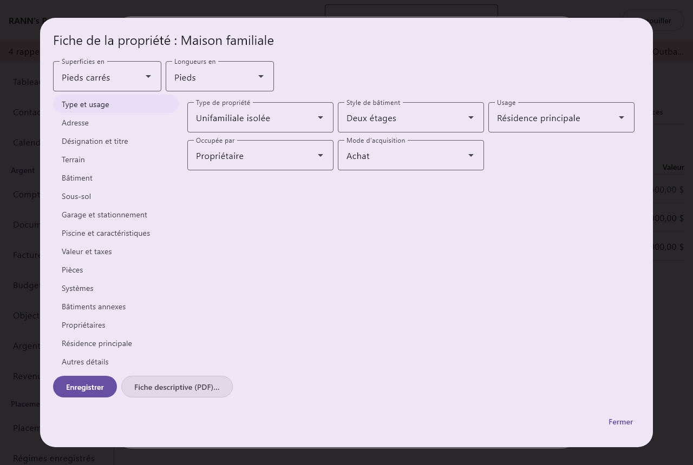
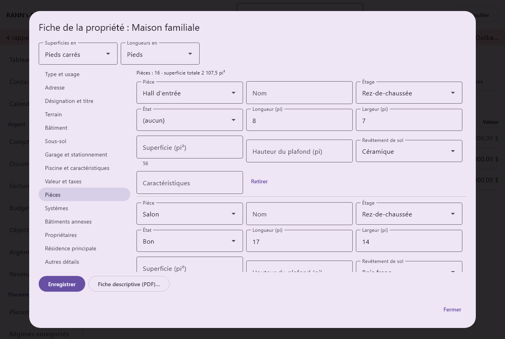
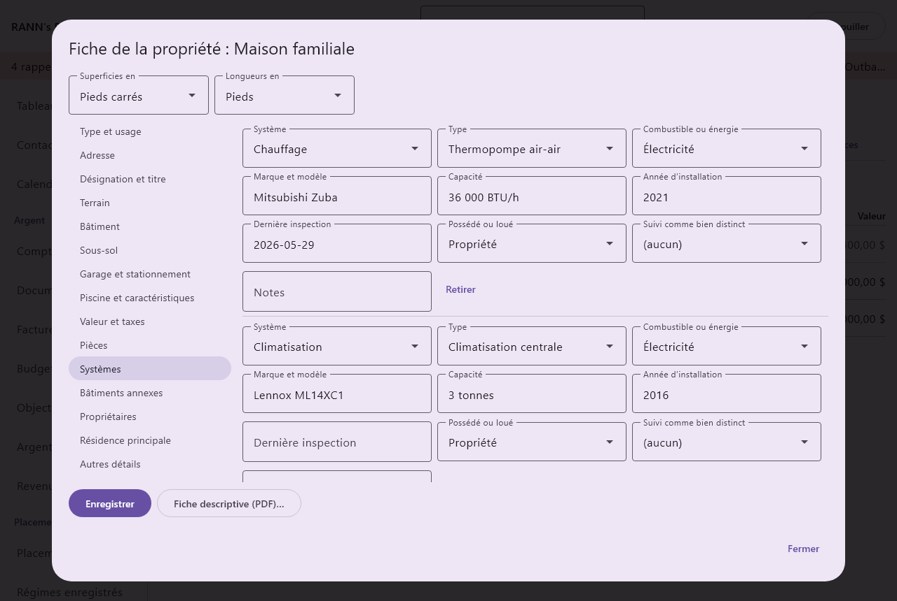
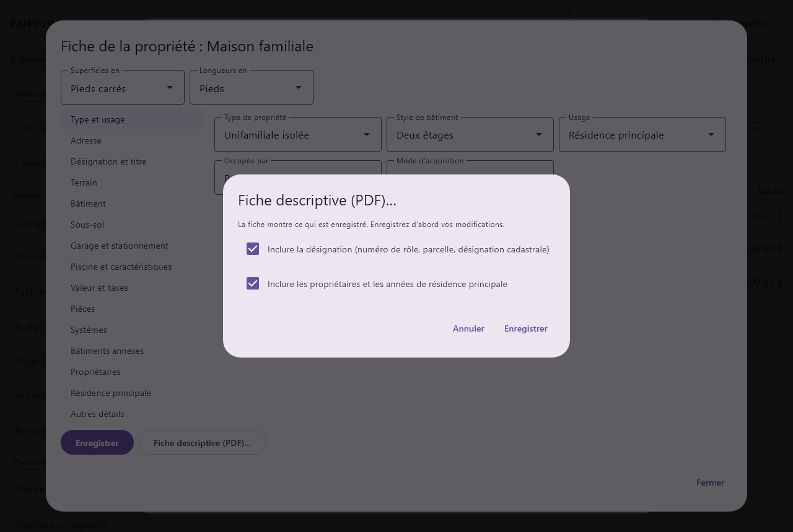

# Fiche de la propriété

La fiche de la propriété réunit tout ce qui concerne une maison, un chalet, un condo, un terrain ou un bâtiment : son adresse et sa désignation cadastrale, le terrain, le bâtiment, chaque pièce, la fournaise et le puits, les bâtiments annexes, les personnes inscrites au titre et les années où elle a été votre résidence principale. Tout est facultatif : notez seulement l’adresse d’un chalet, ou chaque détail de la maison. Ce que vous notez peut être imprimé dans une fiche descriptive pour un assureur, un acheteur, un liquidateur ou un entrepreneur.

@index: immobilier; maison; chalet; condo; terrain; bâtiment; numéro de rôle; matricule; parcelle; NIP; PID; cadastre; fiche descriptive; T2091; résidence principale

## Ouvrir la fiche de la propriété {#open}

1. Ouvrez [Maison et biens](assets), onglet **Biens**.
2. Cliquez sur une maison, un chalet, un condo, un terrain ou un bâtiment, ou ajoutez-en un avec **Ajouter un bien** en choisissant son **Type**. Voir [Ajouter ou modifier un bien](assets#asset-form).
3. Enregistrez le bien, puis cliquez sur **Fiche de la propriété…**. Le bouton est sous les boutons du bien, au-dessus des garanties ; il n’apparaît que pour les types **Maison**, **Chalet**, **Condo**, **Terrain** et **Immeuble**, et seulement une fois le bien enregistré.

La boîte s’intitule « Fiche de la propriété : » suivi du nom du bien. Il faut la permission **Modification** sur le groupe du bien pour enregistrer des changements.

## La boîte en un coup d’œil {#dialog}

- **Superficies en** : **Pieds carrés** (par défaut), **Mètres carrés**, **Acres** ou **Hectares**. Chaque champ de superficie montre son unité dans son libellé, par exemple « Superficie du terrain (pi²) ».
- **Longueurs en** : **Pieds** (par défaut) ou **Mètres**, pour chaque longueur, largeur et hauteur.
  Changer d’unité convertit les nombres déjà tapés, dans chaque onglet, et le ménage garde votre choix pour chaque propriété et chaque utilisateur. L’application garde les dimensions en système métrique en coulisse : rien ne se perd à passer d’une unité à l’autre, et une dimension tapée en pieds revient exactement en pieds.
- Les onglets : **Type et usage**, **Adresse**, **Désignation et titre**, **Terrain**, **Bâtiment**, **Sous-sol**, **Garage et stationnement**, **Piscine et caractéristiques**, **Copropriété ou coopérative**, **Valeur et taxes**, **Pièces**, **Systèmes**, **Bâtiments annexes**, **Propriétaires**, **Résidence principale** et **Autres détails**. Ils sont listés à gauche ; cliquez sur l’un d’eux pour l’afficher. **Copropriété ou coopérative** n’apparaît que pour un condo. Un terrain n’a pas d’onglet **Bâtiment**, **Sous-sol** ni **Pièces**.
- **Enregistrer** : enregistre tous les onglets d’un coup et laisse la boîte ouverte. Quand une valeur ne convient pas, un message dit ce qui ne va pas et rien n’est enregistré.
- **Fiche descriptive (PDF)…** : voir [La fiche descriptive](property#fact-sheet).
- **Fermer** : ferme la boîte. Les changements non enregistrés avec **Enregistrer** sont perdus.

La façon d’entrer une valeur dépend du champ :

- Une liste de choix commence par « (aucun) ». Quand vous choisissez **Autre**, une case **Autre (préciser)** s’ouvre pour vos propres mots ; ils ne sont gardés que tant qu’Autre est choisi.
- Un champ à plusieurs choix, comme **Revêtement extérieur**, montre chaque choix comme un bouton que vous activez ou désactivez d’un clic.
- Un champ oui ou non offre « (aucun) », **Oui** et **Non** : « inconnu » reste différent de « non ».
- Les nombres prennent le séparateur décimal de votre langue (1,5 en français, 1.5 en anglais). Les dimensions, les nombres et les montants ne peuvent pas être négatifs.
- Une année va de 1600 à cinq ans à partir d’aujourd’hui. Une date s’écrit aaaa-mm-jj.
- Les champs de texte acceptent jusqu’à 200 caractères ; les grandes cases (descriptions et notes), jusqu’à 4 000.
- Les montants sont dans la devise du bien.

> Remarque : La fiche de la propriété est un registre. Elle ne change ni la valeur du bien, ni la valeur nette, ni les budgets, les impôts ou les rappels : la valeur se fixe sur le bien lui-même (voir [Valeur et valeur nette](assets#value)). Ces détails paraissent sur la fiche descriptive, et l’adresse, le numéro de rôle et la parcelle aussi dans le [sommaire d’urgence](property#elsewhere), l’inventaire du domicile et une [propriété locative](property#elsewhere).

## Onglet Type et usage {#identification}

- **Type de propriété** : **Unifamiliale isolée**, **Jumelée**, **En rangée**, **Duplex**, **Triplex**, **Quadruplex**, **Appartement en copropriété**, **Maison en rangée en copropriété**, **Maison mobile ou usinée**, **Chalet ou camp**, **Ferme**, **Terrain vacant**, **Terrain récréatif**, **Commercial**, **Industriel**, **Usage mixte**, **Multilogement** ou **Autre**.
- **Style de bâtiment** : **Plain-pied (bungalow)**, **Bungalow surélevé**, **Un étage et demi**, **Deux étages**, **Deux étages et demi**, **Trois étages**, **Paliers multiples**, **Paliers arrière**, **Paliers latéraux**, **Bi-niveau**, **En A**, **Chalet**, **Maison en bois rond**, **Poutres et poteaux**, **Victorien**, **Édouardien**, **Cape Cod**, **Colonial**, **Craftsman**, **Tudor**, **Ranch**, **Contemporain ou moderne**, **Canadienne (style québécois)**, **Plex montréalais** ou **Autre**.
- **Usage** : comment la propriété sert : **Résidence principale**, **Résidence secondaire**, **Saisonnier ou récréatif**, **Location**, **En partie louée**, **Ferme**, **Entreprise**, **Vacante** ou **Autre**.
- **Occupée par** : qui y habite : **Propriétaire**, **Locataires**, **Propriétaire et locataires** ou **Personne**.
- **Mode d’acquisition** : **Achat**, **Construction neuve**, **Héritage**, **Don**, **Transfert entre conjoints** ou **Autre**. Utile plus tard pour le prix de base et une succession.

## Onglet Adresse {#address}

- **Appartement** : le numéro d’appartement ou de bureau.
- **Numéro civique** et **Rue**.
- **Adresse, ligne 2** : une route rurale, une case postale ou tout autre complément d’adresse.
- **Municipalité** : la ville, le village ou le canton.
- **Comté, MRC ou région** : le comté, la municipalité régionale ou le district, s’il y a lieu.
- **Province ou territoire** : choisie dans la liste des provinces et territoires.
- **Code postal** : pour une adresse au Canada, s’écrit A1A 1A1 ; l’application ajoute l’espace et les majuscules. Un autre format est refusé avec « Entrez un code postal canadien sous la forme A1A 1A1. », sauf si un autre pays que le Canada est indiqué.
- **Pays** : un code de pays à deux lettres, CA pour le Canada ou US pour les États-Unis. Vide veut dire le Canada.
- **Numéro civique d’urgence** : Le numéro affiché au chemin pour le 911, quand il diffère du numéro civique. Courant pour les chalets et les maisons en campagne.
- **Latitude** et **Longitude** : en degrés décimaux, par exemple 45,4215 et -75,6972. Facultatif, inscrit à la main ; rien n’est cherché sur une carte. La latitude va de -90 à 90 et la longitude de -180 à 180.
- **Itinéraire** : comment s’y rendre, pour un visiteur, un entrepreneur ou une urgence.

Partout où l’adresse est montrée, ses lignes sont réunies dans l’ordre canadien habituel (appartement et numéro, rue, ligne 2, municipalité, province, code postal).

## Onglet Désignation et titre {#legal}

Ces renseignements viennent de votre acte, de votre titre ou de votre avis d’évaluation. Laissez de côté ce qui ne s’applique pas dans votre province.

- **Numéro de rôle d’évaluation** : Comme sur l’avis d’évaluation : matricule au Québec, ARN de 19 chiffres en Ontario, numéro de rôle ou folio en C.-B. Paraît dans le sommaire d’urgence et l’inventaire du domicile.
- **Identifiant de la parcelle** : Numéro de lot du cadastre du Québec, PIN en Ontario, PID en C.-B., titre ou LINC en Alberta, ou le numéro de parcelle de votre province. Paraît dans le sommaire d’urgence et l’inventaire du domicile.
- **Lot**, **Plan**, **Concession**, **Bloc** et **Partie** : les éléments de la désignation, tels qu’écrits dans l’acte (par exemple lot 27, plan 4M-1182, ou partie 2 d’un plan de renvoi).
- **Canton géographique** : l’ancien nom de canton, utilisé dans les désignations en Ontario.
- **Description d’arpentage** : Section, canton, rang et méridien dans les Prairies ; lot de district en C.-B.
- **Désignation cadastrale complète** : la désignation complète, copiée de l’acte ou du titre.
- **Numéro de titre ou d’inscription** : le numéro de l’acte ou du transfert tel qu’inscrit.
- **Bureau de la publicité des droits ou des titres** : le bureau d’enregistrement ou de la publicité des droits où il est inscrit.
- **Mode de tenure** : comment le terrain est détenu : **Pleine propriété**, **Copropriété divise**, **Coopérative**, **Bail emphytéotique ou foncier**, **Bail viager**, **Bail sur terre publique** ou **Autre**.
- **Fin du bail** : pour un bail emphytéotique, un bail viager ou un bail de la Couronne.
- **Dernier certificat de localisation** et **Arpenteur-géomètre** : le dernier levé ou certificat de localisation, et qui l’a fait.
- **Servitudes et droits de passage** : les droits que d’autres ont sur le terrain, comme une entrée partagée, une ligne électrique ou un sentier vers le lac.
- **Restrictions et clauses** : les restrictions et servitudes inscrites au titre.

## Onglet Terrain {#land}

- **Superficie du terrain** : la superficie du terrain, dans l’unité de superficie choisie en haut.
- **Façade** et **Profondeur** : dans l’unité de longueur choisie en haut.
- **Forme du terrain** : **Rectangulaire**, **Irrégulière**, **En pointe de tarte**, **Terrain de coin**, **En drapeau** ou **Autre**.
- **Topographie** : **Plat**, **Légère pente**, **En pente**, **Vallonné**, **Ravin**, **En terrasses** ou **Autre**.
- **Sol** : **Argile**, **Loam**, **Sable**, **Gravier**, **Roc ou Bouclier canadien**, **Organique ou tourbe** ou **Autre**.
- **Drainage** : **Bon**, **Passable**, **Mauvais**, **Drainage souterrain** ou **Autre**.
- **Végétation** : **Pelouse**, **Aménagement paysager**, **Boisé**, **Partiellement boisé**, **Défriché**, **Terre agricole**, **Naturel** ou **Autre**.
- **Bord de l’eau** : **Aucun**, **Lac**, **Rivière**, **Ruisseau**, **Mer ou océan**, **Étang**, **Canal** ou **Autre**.
- **Façade sur l’eau** : la longueur de rive.
- **Rive** : **Sable**, **Roc**, **Mixte**, **Herbeuse**, **Mur de soutènement** ou **Autre**.
- **Profondeur de l’eau au quai** : utile pour un bateau.
- **Vue** : dans vos propres mots.
- **Accès** : **Chemin municipal à l’année**, **Chemin privé à l’année**, **Chemin saisonnier**, **Accès par l’eau seulement**, **Par avion** ou **Autre**.
- **Chemin entretenu par** : la municipalité, une association de chemin ou les propriétaires, pour un chemin privé ou saisonnier.
- **Clôture** : **Aucune**, **Partielle**, **Complète** ou **Autre**.
- **Zonage** : le zonage, tel que la municipalité l’écrit (R1, RU, A…).
- **Désignations du terrain** : celles qui s’appliquent : **Réserve de terres agricoles (C.-B.)**, **Ceinture de verdure (Ontario)**, **Moraine d’Oak Ridges**, **Escarpement du Niagara**, **Zone agricole (CPTAQ, Québec)**, **Zone inondable**, **Réglementé par un office de protection de la nature**, **Désignation patrimoniale**, **Protection de l’environnement** ou **Autre**.
- **Superficie cultivable**, **Pâturage** et **Boisé** : pour une ferme ou un terrain rural, dans l’unité de superficie choisie en haut.

## Onglet Bâtiment {#building}

Le bâtiment principal. Absent pour un terrain.

- **Année de construction**, avec **Année de construction estimée** quand l’année est une estimation.
- **Constructeur**.
- **Rénovations majeures** : ce qui a été fait et quand, comme « 2016 cuisine ; 2021 sous-sol ».
- **Étages hors sol** : Hors sol, par exemple 1,5 pour un étage et demi.
- **Nombre total de niveaux** : tous les étages, sous-sol compris.
- **Superficie habitable hors sol**, **Superficie aménagée au sous-sol**, **Superficie totale de plancher** et **Superficie au sol** : dans l’unité de superficie choisie en haut. L’emprise au sol est la surface que couvre le bâtiment.
- **Hauteur du plafond, rez-de-chaussée** : dans l’unité de longueur choisie en haut.
- **Logements** : le nombre de logements, pour un duplex ou un immeuble.
- **Chambres**, **Salles de bain complètes**, **Salles d’eau** et **Cuisines** : des nombres entiers. Ils sont tapés, pas comptés d’après l’onglet **Pièces**.
- **Construction** : **Ossature de bois**, **Maçonnerie ou brique**, **Double brique**, **Blocs de béton**, **Béton coulé**, **Coffrages isolants (ICF)**, **Panneaux structuraux isolés (SIP)**, **Ossature d’acier**, **Bois rond**, **Poutres et poteaux**, **Modulaire ou préfabriquée**, **Ballots de paille** ou **Autre**.
- **Fondation** : **Béton coulé**, **Blocs de béton**, **Pierre**, **Bois traité**, **Dalle sur sol**, **Piliers ou pieux**, **Pieux vissés**, **Vide sanitaire** ou **Autre**.
- **Revêtement extérieur** : ceux qui s’appliquent : **Brique**, **Pierre**, **Vinyle**, **Aluminium**, **Bois**, **Bardeaux de cèdre**, **Fibrociment**, **Crépi ou stuc**, **Isolation extérieure (EIFS)**, **Bois rond**, **Métal** ou **Autre**.
- **Forme du toit** : **À deux versants**, **À quatre versants**, **Plat**, **Mansardé**, **En croupe brisée (gambrel)**, **À un versant**, **En A**, **Combiné** ou **Autre**.
- **Revêtement de toiture** : **Bardeaux d’asphalte**, **Tôle ou métal**, **Bardeaux de cèdre**, **Ardoise**, **Tuiles d’argile ou de béton**, **Membrane de caoutchouc (EPDM)**, **Goudron et gravier**, **Membrane TPO**, **Toit vert** ou **Autre**.
- **Toiture refaite en**, **Fenêtres remplacées en** et **Portes remplacées en** : les années du dernier remplacement. Les assureurs demandent l’âge du toit.
- **Vitrage des fenêtres** : **Simple vitrage**, **Double vitrage**, **Triple vitrage** ou **Mixte**.
- **Cadres des fenêtres** : **PVC**, **Bois**, **Aluminium**, **Fibre de verre**, **Bois recouvert** ou **Autre**.
- **Isolation du grenier (R)**, **Isolation des murs (R)** et **Isolation du sous-sol (R)** : les valeurs R, d’après une évaluation énergétique ou le constructeur.
- **Cote ÉnerGuide** : Le nombre inscrit sur l’étiquette ÉnerGuide ; choisissez son échelle ci-dessous.
- **Échelle ÉnerGuide** : **Gigajoules par année (depuis 2013)** ou **Cote de 0 à 100 (avant 2013)**.
- **Évaluation énergétique** : la date de la dernière évaluation énergétique.
- **Murs intérieurs** : **Gypse**, **Plâtre**, **Lambris** ou **Autre**.
- **Revêtements de sol** : ceux qui s’appliquent : **Bois franc**, **Bois d’ingénierie**, **Stratifié**, **Vinyle ou planches de vinyle**, **Céramique**, **Tapis**, **Béton**, **Liège** ou **Autre**.
- **Foyers** : combien.
- **Accessibilité** : ceux qui s’appliquent : **Entrée sans marche**, **Rampe d’accès**, **Chambre au rez-de-chaussée**, **Salle de bain au rez-de-chaussée**, **Monte-escalier**, **Ascenseur**, **Portes larges**, **Douche sans seuil** ou **Autre**.
- **Matières dangereuses connues** : ceux qui sont connus : **Amiante**, **Isolant de vermiculite**, **Mousse d’urée-formaldéhyde (MIUF)**, **Peinture au plomb**, **Câblage à boutons et tubes**, **Câblage d’aluminium**, **Tuyaux de polybutylène**, **Réservoir de mazout en service**, **Réservoir de mazout retiré**, **Radon testé** ou **Autre**. Les assureurs et les acheteurs posent la question.
- **Notes sur les matières dangereuses** : ce qui a été trouvé, analysé ou enlevé, et quand.
- **Test de radon le** et **Concentration de radon (Bq/m³)** : La ligne directrice de Santé Canada est de 200 Bq/m³.

## Onglet Sous-sol {#basement}

Absent pour un terrain.

- **Sous-sol** : **Complet**, **Partiel**, **Vide sanitaire**, **Aucun (dalle)**, **Avec sortie de plain-pied**, **Avec escalier extérieur**, **Avec grandes fenêtres**, **Cave** ou **Autre**.
- **Finition** : **Aménagé**, **Partiellement aménagé** ou **Non aménagé**.
- **Hauteur** : dans l’unité de longueur choisie en haut.
- **Entrée indépendante** et **Logement secondaire** : oui ou non.
- **Notes sur le logement** : par exemple si le logement est enregistré auprès de la municipalité.
- **Imperméabilisation** : **Intérieure**, **Extérieure**, **Membrane** ou **Aucune connue**.
- **Pompe de puisard** : **Aucune**, **Une pompe**, **Avec pompe de secours à batterie** ou **Avec pompe de secours à eau**.
- **Clapet antiretour** : Les assureurs le demandent souvent ; il empêche les eaux d’égout de refouler au sous-sol.
- **Dégâts d’eau passés** : ce qui s’est passé et quand, et ce qui a été réparé.

## Onglet Garage et stationnement {#parking}

- **Garage** : **Aucun**, **Attenant**, **Intégré**, **Détaché**, **Abri d’auto**, **Souterrain** ou **Autre**.
- **Places au garage** et **Places de stationnement extérieures** : combien de voitures.
- **Garage chauffé**, **Garage isolé** et **Ouvre-porte de garage** : oui ou non.
- **Entrée** : **Asphalte**, **Béton**, **Pavé uni**, **Gravier**, **Partagée**, **Aucune** ou **Autre**.

Un garage détaché peut aussi être inscrit dans l’onglet **Bâtiments annexes**, avec sa superficie.

## Onglet Piscine et caractéristiques {#features}

- **Piscine** : **Aucune**, **Creusée**, **Hors terre**, **Semi-creusée** ou **Intérieure**.
- **Forme de la piscine** et **Dimensions ou volume de la piscine** : dans vos propres mots, comme « Haricot » ou « 16 x 32 pi, 40 000 L ».
- **Toile ou revêtement de la piscine** : **Toile de vinyle**, **Béton**, **Fibre de verre** ou **Autre**.
- **Traitement de l’eau de la piscine** : **Chlore**, **Sel**, **Minéraux** ou **Autre**.
- **Chauffage de la piscine** : **Aucun**, **Chauffe-piscine au gaz**, **Thermopompe**, **Solaire** ou **Autre**.
- **Toile de la piscine** et **Piscine clôturée** : oui ou non. Bien des assureurs et des municipalités exigent une piscine clôturée.
- **Terrasse** : **Aucune**, **Bois traité**, **Cèdre**, **Composite**, **PVC**, **Béton**, **Pierre** ou **Autre**.
- **Superficie de la terrasse** : dans l’unité de superficie choisie en haut.
- Oui ou non : **Spa**, **Patio**, **Galerie ou véranda**, **Balcon**, **Système d’irrigation**, **Cuisine extérieure**, **Module de jeux**, **Foyer extérieur**, **Éclairage paysager**, **Aspirateur central**, **Ascenseur**, **Bar avec évier**, **Système de son intégré** et **Puits de lumière**.

Une piscine ou un spa qui demande son propre entretien peut être un bien distinct, de type **Piscine** : voir [L’entretien d’un bien](assets#asset-maintenance).

## Onglet Copropriété ou coopérative {#condo}

N’apparaît que pour un bien de type **Condo**.

- **Syndicat de copropriété** : Nom et numéro, par exemple le numéro d’immatriculation du syndicat ou du plan de copropriété.
- **Partie privative et niveau** : la partie privative et le niveau légaux, qui peuvent différer du numéro d’appartement.
- **Frais de copropriété par mois** : les frais, en montant. C’est un registre seulement : pour les payer et recevoir un rappel, ajoutez-les dans [Factures](bills).
- **Les frais comprennent** : ce qui s’applique : **Chauffage**, **Électricité**, **Eau**, **Assurance de l’immeuble**, **Stationnement**, **Casier**, **Câble ou Internet**, **Parties communes** ou **Autre**.
- **Place de stationnement** et **Casier**.
- **Orientation** : l’orientation du logement : **Nord**, **Nord-est**, **Est**, **Sud-est**, **Sud**, **Sud-ouest**, **Ouest** ou **Nord-ouest**.
- **Commodités** : ce qui s’applique : **Concierge**, **Salle d’entraînement**, **Piscine**, **Salle de réception**, **Suite pour invités**, **Terrasse sur le toit**, **Stationnement pour visiteurs**, **Lave-auto**, **Bornes de recharge** ou **Autre**.
- **Gestionnaire immobilier** : choisi parmi vos [Contacts](contacts).
- **Étude du fonds de prévoyance** : la date de la dernière étude du fonds de prévoyance.
- **Cotisation spéciale** et **À propos de la cotisation spéciale** : un montant exigé des copropriétaires et à quoi il sert.
- **Animaux permis** et **Location permise** : oui ou non.
- **Notes sur les règlements** : les règles à retenir.

## Onglet Valeur et taxes {#value-tax}

@index: évaluation foncière; SÉFM; MPAC; BC Assessment; taxe foncière; coût de reconstruction; soutien scolaire

- **Valeur au rôle** et **Année du rôle** : d’après le dernier avis d’évaluation.
- **Valeur au rôle du terrain** et **Valeur au rôle du bâtiment** : quand l’avis les donne séparément.
- **Organisme d’évaluation** : Par exemple la municipalité ou la MRC, la MPAC ou BC Assessment.
- **Numéro de compte de taxes** : quand le compte de taxes utilise un autre numéro que le numéro de rôle.
- **Taxes foncières par année** : la taxe de l’année, en montant.
- **Compte de taxes foncières** : choisie parmi vos [Factures](bills) : la facture avec laquelle vous payez la taxe. La facture garde ses propres montants, versements et rappels.
- **Soutien scolaire** : Ontario seulement : le conseil scolaire que vos taxes foncières soutiennent. **Public de langue anglaise**, **Séparé de langue anglaise**, **Public de langue française** ou **Séparé de langue française**.
- **Coût de reconstruction assuré** : Ce que l’assureur estime pour reconstruire, d’après votre police.
- **Valeur marchande estimée**, **Estimée le** et **Estimée par** : le prix de vente possible, à quelle date, et selon qui (un courtier, une évaluation, votre propre estimation). Cela ne change pas la valeur du bien : entrez celle-ci sur le bien lui-même.
- **Hypothèque ou marge de crédit** : choisi parmi vos [Comptes](accounts) : le prêt hypothécaire ou la marge de crédit sur la propriété.

Un élément choisi parmi vos factures, comptes ou contacts puis supprimé est tout simplement omis de la fiche descriptive.

## Onglet Pièces {#rooms}

Absent pour un terrain. La ligne du haut compte les pièces et additionne leurs superficies. Chaque pièce a :

- **Pièce** : **Chambre**, **Chambre principale**, **Salle de bain**, **Salle de bain attenante**, **Salle d’eau**, **Cuisine**, **Cuisinette**, **Salle à manger**, **Salon**, **Salle familiale**, **Grande pièce**, **Bureau**, **Bibliothèque**, **Salle de lavage**, **Vestibule**, **Hall d’entrée**, **Corridor**, **Salle de jeux**, **Salle de cinéma maison**, **Salle de loisirs**, **Salle d’entraînement**, **Atelier**, **Salle mécanique**, **Rangement**, **Chambre froide**, **Cellier à vin**, **Garde-manger**, **Walk-in**, **Verrière**, **Solarium quatre saisons**, **Galerie moustiquaire**, **Mezzanine**, **Grenier**, **Chambre de bébé**, **Chambre d’amis**, **Logement intergénérationnel**, **Pièce supplémentaire** ou **Autre**. Chambre par défaut.
- **Nom** : pour distinguer les pièces, comme « Chambre de Lily ».
- **Étage** : **Second sous-sol**, **Sous-sol**, **Rez-de-chaussée**, **Deuxième étage**, **Troisième étage**, **Quatrième étage**, **Mezzanine ou grenier** ou **Autre**.
- **État** : **Excellent**, **Bon**, **Passable** ou **À rénover**.
- **Longueur** et **Largeur** : dans l’unité de longueur choisie en haut.
- **Superficie** : dans l’unité de superficie choisie en haut. Laissez-la vide et l’application prend la longueur multipliée par la largeur, montrée sous la case ; tapez une superficie pour une pièce qui n’est pas rectangulaire.
- **Hauteur du plafond** : dans l’unité de longueur choisie en haut.
- **Revêtement de sol** : **Bois franc**, **Bois d’ingénierie**, **Stratifié**, **Vinyle ou planches de vinyle**, **Céramique**, **Tapis**, **Béton**, **Liège** ou **Autre**.
- **Caractéristiques** : dans vos propres mots, comme « Garde-robe de plain-pied, fenêtre en baie ».
- **Retirer** : retire la pièce de la liste à l’enregistrement.

**Ajouter une pièce** ajoute une pièce à la fin. Les pièces gardent l’ordre dans lequel vous les ajoutez.

## Onglet Systèmes {#systems}

La fournaise, le chauffe-eau, le puits, la fosse septique et le reste. Chaque système a :

- **Système** : **Chauffage**, **Climatisation**, **Eau chaude**, **Ventilation**, **Électricité**, **Plomberie**, **Approvisionnement en eau**, **Traitement de l’eau**, **Eaux usées**, **Foyer ou poêle**, **Solaire**, **Génératrice**, **Borne de recharge**, **Sécurité**, **Protection incendie**, **Internet et téléphone**, **Aspirateur central**, **Puisard et drainage** ou **Autre**. Chauffage par défaut.
- **Type** : les choix dépendent du système. Chauffage : **Fournaise à air pulsé**, **Chaudière et radiateurs**, **Plancher radiant**, **Plinthes électriques**, **Thermopompe air-air**, **Géothermie**, **Thermopompe murale sans conduit**, **Poêle à bois**, **Poêle à granules**, **Fournaise au bois**, **Chaudière extérieure au bois**, **Appareils d’appoint** ou **Autre**. Climatisation : **Climatisation centrale**, **Thermopompe**, **Thermopompe murale sans conduit**, **Climatiseurs de fenêtre ou portatifs**, **Aucune** ou **Autre**. Eau chaude : **Chauffe-eau à réservoir**, **Chauffe-eau instantané**, **Chauffe-eau thermodynamique**, **Combiné à la chaudière**, **Solaire** ou **Autre**. Ventilation : **Échangeur d’air récupérateur de chaleur (VRC)**, **Échangeur d’air récupérateur d’énergie (VRE)**, **Ventilateurs d’extraction seulement** ou **Autre**. Électricité : **Panneau à disjoncteurs**, **Panneau à fusibles**, **Câblage de cuivre**, **Câblage d’aluminium**, **Câblage à boutons et tubes**, **Câblage mixte** ou **Autre**. Plomberie : **Tuyaux d’alimentation en cuivre**, **Tuyaux d’alimentation en PEX**, **Tuyaux d’acier galvanisé**, **Tuyaux de polybutylène**, **Tuyaux de PVC-C**, **Tuyaux de plomb**, **Drains en ABS ou PVC**, **Drains en fonte**, **Mixte** ou **Autre**. Approvisionnement en eau : **Aqueduc municipal**, **Puits artésien**, **Puits de surface**, **Pointe filtrante**, **Prise d’eau au lac ou à la rivière**, **Citerne**, **Puits partagé** ou **Autre**. Traitement de l’eau : **Adoucisseur**, **Système UV**, **Osmose inverse**, **Filtre**, **Chlorateur** ou **Autre**. Eaux usées : **Égout municipal**, **Fosse septique et champ d’épuration**, **Fosse de rétention**, **Système tertiaire**, **Toilette sèche ou à compost** ou **Autre**. Foyer ou poêle : **Bois**, **Gaz naturel**, **Propane**, **Électrique**, **Granules** ou **Autre**. Sécurité : **Système d’alarme sous surveillance**, **Système d’alarme sans surveillance**, **Caméras**, **Serrures intelligentes** ou **Autre**. Protection incendie : **Avertisseurs de fumée**, **Avertisseurs de monoxyde de carbone**, **Gicleurs**, **Sous surveillance** ou **Autre**. Les autres systèmes n’ont pas de type ; utilisez **Marque et modèle** et **Notes**. Changer de système efface le type.
- **Combustible ou énergie** : **Gaz naturel**, **Propane**, **Mazout**, **Électricité**, **Bois**, **Granules**, **Solaire**, **Géothermie**, **Aucune** ou **Autre**.
- **Marque et modèle** et **Capacité** : comme « Lennox EL296V » et « 80 000 BTU » ou « 189 L ».
- **Année d’installation** et **Dernière inspection** (une date).
- **Possédé ou loué** : **Propriété**, **Location**, **Crédit-bail** ou **Financé**. Beaucoup de chauffe-eau et certaines fournaises sont loués. Pour **Location** ou **Crédit-bail**, deux cases s’ajoutent : **Loué de** et **Loyer par mois**. Le loyer est un registre seulement : pour le payer et recevoir un rappel, ajoutez-le dans [Factures](bills).
- **Suivi comme bien distinct** : un autre bien qui est ce système, comme la fournaise ajoutée dans l’onglet Biens avec sa garantie et ses tâches d’entretien. Le système renvoie alors à ce bien, et la fiche descriptive le nomme. Sa garantie, son entretien et son carnet d’entretien restent sur ce bien.
- **Notes**.
- **Retirer**.

**Ajouter un système** en ajoute un à la fin.

## Onglet Bâtiments annexes {#structures}

Le garage, la remise, le quai, le sauna et les autres bâtiments et installations sur le terrain :

- **Bâtiment annexe ou installation** : **Garage détaché**, **Remise**, **Grange**, **Atelier**, **Dortoir ou chalet d’invités**, **Hangar à bateaux**, **Quai fixe**, **Quai flottant**, **Quai sur caissons**, **Élévateur à bateau**, **Sauna**, **Gazebo**, **Serre**, **Pavillon-jardin ou maison de ruelle**, **Silo**, **Hangar à machinerie**, **Chenil ou écurie** ou **Autre**.
- **Nom** : comme « Hangar à bateaux de la baie ».
- **Superficie** : dans l’unité de superficie choisie en haut.
- **Année de construction** et **Construction** (dans vos propres mots).
- **Chauffé**, **Électricité** et **Eau** : cochez ce qu’il a.
- **Suivi comme bien distinct** : comme pour un système, un autre bien qui est ce bâtiment, comme un quai dont vous suivez l’entretien.
- **Notes** et **Retirer**.

**Ajouter un bâtiment annexe ou une installation** en ajoute un à la fin.

## Onglet Propriétaires {#owners}

@index: titre; propriété conjointe; copropriété indivise; part de propriété

Les personnes inscrites au titre. Donnez une part à chaque propriétaire, ou à aucun ; le total des parts est de 100 %.

- **Propriétaire** : un membre du ménage. Chaque membre ne peut figurer qu’une fois.
- **Part (%)** : la part du membre, comme 50 ou 33,33. Laissez toutes les parts vides si vous ne les connaissez pas. Si certaines sont données et d’autres non, ou si leur total n’est pas 100, l’enregistrement affiche « Donnez une part à chaque propriétaire, ou à aucun, et faites que les parts totalisent 100 %. »
- **Mode de détention du titre** : **Propriétaire unique**, **Propriété conjointe avec droit de survie**, **Copropriété indivise**, **Fiducie**, **Société** ou **Autre**.
- **Retirer**.

**Ajouter un propriétaire** ajoute le prochain membre du ménage qui n’est pas encore dans la liste ; changez le nom au besoin. Le bouton disparaît quand tous les membres y sont.

Les propriétaires sont un registre pour la fiche descriptive et vos papiers de succession. Ils ne changent ni le **Propriétaire** du bien dans l’onglet Biens, ni la répartition de la valeur nette.

## Onglet Résidence principale {#residence}

@index: exemption pour résidence principale; T2091; gain en capital; désignation

Les années où chaque personne a désigné cette propriété comme sa résidence principale, pour aider à remplir le formulaire T2091 de l’ARC à la vente. Depuis 1982, une unité familiale ne peut désigner qu’une propriété par année.

- Une case **Années désignées par** suivi du nom de la personne, pour chaque personne de l’onglet [Propriétaires](property#owners) ; quand cet onglet est vide, pour chaque adulte du ménage. Une personne qui a déjà des années ici garde sa case. Tapez les années seules ou en plages, séparées par des virgules : « 2015-2019, 2023 ». Après l’enregistrement, elles reviennent triées et regroupées en plages. Laissez la case vide pour une personne qui n’a pas désigné cette propriété.

Après l’enregistrement, l’onglet avertit en rouge quand le ménage a désigné une autre propriété pour la même année : « En 2023, la famille a aussi désigné : Chalet ». À partir de 1982, la vérification vaut pour toute la famille ; pour les années antérieures, pour chaque personne. Voyez avec la personne qui prépare votre déclaration quelle propriété désigner.

> Important : C’est une aide pour vos dossiers, pas un conseil fiscal. La désignation elle-même se fait dans votre déclaration de revenus, à la vente de la propriété.

## Onglet Autres détails {#custom}

Tout ce que les autres onglets n’ont pas, dans vos propres mots, comme « Profondeur du puits : 45 m » ou « Numéro du poteau d’Hydro » :

- **Détail** : le nom du détail. Obligatoire ; une ligne sans nom est refusée avec « Donnez un nom à ce détail. »
- **Valeur** : le détail lui-même. Un détail sans valeur est gardé, mais omis de la fiche descriptive.
- **Retirer**.

**Ajouter un détail** en ajoute un à la fin.

## La fiche descriptive {#fact-sheet}

@index: rapport sur la propriété; assurance; vente; liquidateur; PDF

La fiche descriptive est un PDF de tous les détails notés sur la propriété, pour un assureur, un acheteur ou un courtier, un liquidateur ou un entrepreneur.

1. Enregistrez d’abord vos changements : la fiche montre ce qui est enregistré, pas ce qui est tapé.
2. Cliquez sur **Fiche descriptive (PDF)…**.
3. Choisissez ce qu’elle comprend (voir plus bas), cliquez sur **Enregistrer** et choisissez où enregistrer le fichier. Il est nommé « Fiche descriptive - » suivi du nom du bien. **Annuler** ferme sans la faire.

La boîte rappelle : « La fiche montre ce qui est enregistré. Enregistrez d’abord vos modifications. » Les deux cases sont cochées par défaut :

- **Inclure la désignation (numéro de rôle, parcelle, désignation cadastrale)** : décochez-la pour omettre toute la section **Désignation et titre**.
- **Inclure les propriétaires et les années de résidence principale** : décochez-la pour omettre les sections **Propriétaires** et **Résidence principale**.

La fiche porte le titre « Fiche descriptive de la propriété : » suivi du nom du bien, puis le type, l’adresse et la date où elle a été préparée, et une section pour chaque onglet qui contient quelque chose, dans l’ordre des onglets. Chaque ligne est un libellé et sa valeur. Les pièces montrent leur niveau, leurs dimensions, leur superficie, la hauteur du plafond, le revêtement, l’état et les caractéristiques, puis, à partir de deux pièces, la superficie totale des pièces ; les systèmes et les bâtiments annexes montrent ce qui a été entré pour chacun. Les dimensions sont dans les unités choisies en haut de la boîte, et les textes dans la langue de l’application. Les longues valeurs passent à la ligne et la fiche continue sur d’autres pages au besoin.

> Conseil : Une fiche pour un entrepreneur a rarement besoin des propriétaires ou de la désignation : décochez-les. Pour votre testament et vos papiers de succession, gardez les deux.

## Où ces détails paraissent ailleurs {#elsewhere}

- Le **Sommaire d’urgence** dans [Urgence et succession](estate#summary-contents) a une section **Propriétés immobilières** : chaque maison, chalet, condo, terrain et bâtiment avec son type, son adresse, son numéro de rôle et son identifiant de parcelle.
- L’**Inventaire du domicile avec photos (PDF)** du rapport [Biens et garanties](reports#assets-warranties) ajoute l’adresse, le numéro de rôle et la parcelle sous chaque propriété.
- Une [propriété locative](side#rental-dialog) dans Revenus d’appoint peut être liée à la propriété avec **La propriété (parmi les biens)**. Sa carte montre alors l’adresse de la propriété.
- Les choix de maison des [Services publics](utilities) et des projets de l’écran des biens listent les maisons, chalets, condos et bâtiments (et les terrains pour les projets).

## Voir aussi {#related}

- [Maison et biens](assets) : le bien lui-même, sa valeur, ses garanties, son entretien et ses assurances.
- [Urgence et succession](estate) : le sommaire pour votre famille et votre liquidateur.
- [Revenus d’appoint](side#rentals) : les revenus et dépenses de location.
